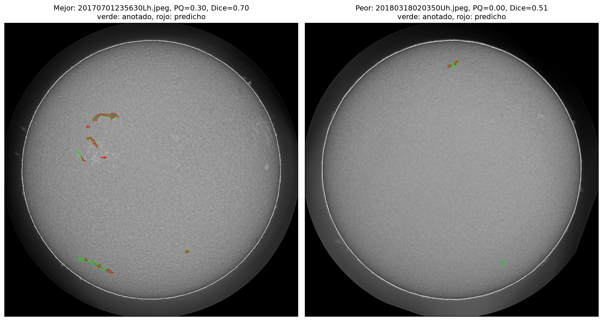

# Segmentación de filamentos solares en imágenes H-alfa


Proyecto del curso **MCD8012 Visión Computacional** (Universidad de Ingeniería y Tecnología, UTEC), basado en la competencia [Solar Filament Segmentation Challenge 2026](https://www.kaggle.com/competitions/filament-segmentation-2026).

**Integrantes:** Armando Canales, Diego Trujillo, Renato Miranda, Joshi Lopez y Piero Freundt.
**Docente:** Itamar F. Salazar Reque.


<sub>Mejor (izquierda) y peor (derecha) imagen de validación del baseline. Verde: filamentos anotados. Rojo: predicción.</sub>

## Contenido

1. [Problema](#problema)
2. [Datos](#datos)
3. [Método: baseline clásico](#método-baseline-clásico)
4. [Resultados de la etapa 1](#resultados-de-la-etapa-1)
5. [Estructura del repositorio](#estructura-del-repositorio)
6. [Cómo reproducir](#cómo-reproducir)
7. [Etapas del proyecto](#etapas-del-proyecto)
8. [Referencias](#referencias)

## Problema

Los filamentos solares son nubes densas de plasma suspendidas por el campo magnético sobre la superficie del Sol. Están en el origen de eyecciones de masa coronal y tormentas solares que pueden afectar redes eléctricas, sistemas GPS, satélites y vuelos polares. Su marcado manual es lento y depende del observador.

El objetivo es **segmentar cada filamento por separado** (segmentación de instancias) a partir de una imagen H-alfa del disco solar completo.

| | |
|---|---|
| **Entrada** | Imagen H-alfa en escala de grises, 2048 por 2048 píxeles, de la red GONG |
| **Salida** | Una máscara binaria por filamento; para Kaggle, codificada en RLE (formato COCO) |
| **Métrica principal** | Panoptic Quality (PQ), la de la competencia |
| **Métricas de apoyo** | Dice e IoU por imagen |

## Datos

El repositorio incluye el conjunto **MAGFiLO 1.0** en su versión para Kaggle (carpeta [`datos/`](datos/)), distribuido bajo licencia [CC BY-NC 4.0](https://creativecommons.org/licenses/by-nc/4.0/).

| Elemento | Cantidad |
|---|---|
| Imágenes de entrenamiento | 707 |
| Filamentos anotados | 8 199 (entre 1 y 26 por imagen) |
| Imágenes de prueba | 180 |

El detalle de los datos está en [`datos/README.md`](datos/README.md).

## Método: baseline clásico

La primera etapa usa solo técnicas clásicas, sin aprendizaje:

| Paso | Operación | Propósito |
|---|---|---|
| 1 | Umbral de Otsu y erosión | Separar el disco solar del fondo y descartar su borde |
| 2 | Cociente entre la imagen y una mediana de ventana grande | Corregir el oscurecimiento hacia el borde del disco |
| 3 | Umbral relativo (`umbral_rel`) | Marcar los píxeles más oscuros que su entorno |
| 4 | Apertura y cierre morfológicos | Eliminar ruido y unir regiones cercanas |
| 5 | Componentes conectadas con área mínima | Obtener una instancia por filamento |

El valor de `umbral_rel` se eligió por PQ en 20 imágenes de entrenamiento. El resultado se reporta en otras 40 imágenes que no se usaron para el ajuste.

## Resultados de la etapa 1

| Métrica (40 imágenes de validación) | Media | Desviación |
|---|---|---|
| Dice | 0,513 | 0,111 |
| IoU | 0,352 | 0,097 |
| **Panoptic Quality** | **0,090** | 0,071 |

| Nivel filamento | TP | FP | FN |
|---|---|---|---|
| Total | 86 | 816 | 239 |

**Lectura de los resultados.** El método ubica la mayoría de los filamentos (Dice cercano a 0,5), pero obtiene un PQ bajo por tres motivos:

- **Fragmentación:** los filamentos largos se dividen en trozos con IoU menor a 0,5, que cuentan como falsos positivos.
- **Detecciones espurias:** alrededor de 20 regiones oscuras pequeñas por imagen que no son filamentos.
- **Bajo contraste:** los filamentos tenues no se detectan.

## Estructura del repositorio

```
.
├── README.md
├── requirements.txt                  librerías y versiones
├── datos/                            MAGFiLO 1.0 (Kaggle 2026)
│   └── MAGFiLO_1.0_Kaggle_2026/
├── notebooks/
│   └── 01_baseline_clasico.ipynb     pipeline completo, con salidas guardadas
├── resultados/
│   ├── ajuste_umbral.png             barrido de umbral_rel
│   ├── distribucion_metricas.png     Dice, IoU y PQ por imagen
│   ├── mejor_y_peor.png              ejemplos de validación
│   ├── metricas_validacion.csv       métricas de cada imagen de validación
│   └── submission.csv                predicción sobre el test, formato Kaggle
└── perfil/
    └── Perfil_Proyecto_Filamentos_Solares.pdf
```

## Cómo reproducir

```bash
git clone <url-del-repositorio>
cd <carpeta-del-repositorio>
pip install -r requirements.txt
```

Luego, ejecutar `notebooks/01_baseline_clasico.ipynb` de principio a fin. Los datos ya están en `datos/`. La ejecución completa toma unos 5 minutos en CPU y regenera los archivos de `resultados/`.

## Etapas del proyecto

| Etapa | Contenido | Estado |
|---|---|---|
| 1. Perfil de Proyecto | Definición del problema, datos, baseline clásico y primeras métricas | Completada |
| 2. Modelo de aprendizaje profundo | U-Net entrenada con las máscaras de MAGFiLO | Pendiente |
| 3. Post-proceso de instancias | Unión de fragmentos y filtrado por forma para mejorar el PQ | Pendiente |

Los organizadores de la competencia consideran valioso un PQ mayor a 0,35, que es la meta para las siguientes etapas.

## Referencias

1. Earth-Space AI Research Lab. (2026). *Solar Filament Segmentation Challenge 2026*. Kaggle. https://www.kaggle.com/competitions/filament-segmentation-2026
2. Ahmadzadeh, A., Adhyapak, R., Chaurasiya, K., et al. (2024). A dataset of manually annotated filaments from H-alpha observations. *Scientific Data*, 11, 1031. https://doi.org/10.1038/s41597-024-03876-y
3. Kirillov, A., He, K., Girshick, R., Rother, C. y Dollár, P. (2019). Panoptic Segmentation. *CVPR*. https://doi.org/10.1109/CVPR.2019.00963
